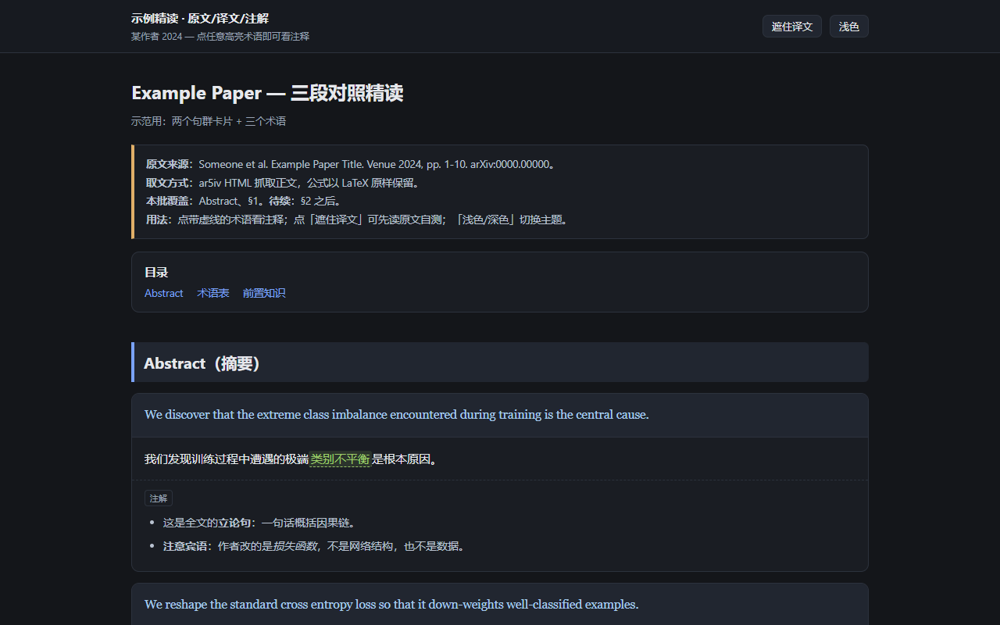

# close-reading-html

把一篇论文（或一章教材、一份技术规范）做成**一个可双击打开的单文件 HTML**：英文原文 + 中文译文 + 中文注解三层对照，按「相邻几句」切成句群卡片，专业术语点一下就弹注释，可以遮住译文自测，术语表可搜索，深/浅色可切换。



## 它解决什么问题

读论文最常见的两种失败：拿到一整段机器翻译，读了跟没读一样；或者逐句啃原文，读到第三节就丢了论证主线。

这个页面把三层信息压在同一屏：左边英文（衬线体、浅蓝）、下面中文、再下面是注解。注解不解释词义，只做四件事——**定位**（这句在论证里干什么）、**定量**（把「压垮」换算成数字）、**纠偏**（作者改的到底是什么）、**连线**（跟你的工作哪里对得上，只在真有数字对得上时才加）。

## 长什么样

- 每个句群卡片：`.en` 原文 → `.zh` 译文 → `.note` 注解，注解里可挂 `.linkbox` 联系框
- 术语：正文里虚线下方划线，点开弹浮层（英文 / 中文 / 一句定义）
- 顶栏两个按钮：「遮住译文」做回译自测，「浅色/深色」切主题（状态存 localStorage）
- 底部术语表：按术语表行文本实时过滤
- 公式：MathJax 渲染，`$...$` 内联、`$$...$$` 块级

## 安装

```bash
# 方式一：克隆到 harness 的 skills 目录（DSH 为例）
git clone https://github.com/kkkkk-tubu/close-reading-html ~/.dsh/skills/close-reading-html

# 方式二：OpenViking（跨机器跨 harness）
ov skills add https://github.com/kkkkk-tubu/close-reading-html
# 或已共享时直接引用：viking://agent/skills/close-reading-html
```

其它 harness 的 skills 目录见 [INSTALL.md](INSTALL.md)（Claude Code / Codex / Cursor / pi / OpenCode）。

## 用法

### 交给 agent（推荐）

> 把这篇论文做成对照精读：https://arxiv.org/abs/1708.02002

skill 会依次做：抓正文 → 切句群 → 写三层 → 标术语 → 生成 → 自检。

### 自己跑脚本

```bash
# 1) 抓正文（ar5iv 优先，公式保留为 LaTeX）
python scripts/extract_paper.py https://ar5iv.labs.arxiv.org/html/1708.02002 -o body.md

# 2) 写一份 spec.json 描述卡片与术语（格式见 examples/spec.example.json）
#    正文里想标术语就写 {key|显示文字}，key 必须在 terms 里登记

# 3) 生成
python scripts/build_from_spec.py spec.json -o 精读_XXX_对照精读.html

# 4) 自检（七项结构性检查）
python scripts/check_reading_html.py 精读_XXX_对照精读.html
```

`build_from_spec.py` 会当场校验术语登记：spec 里用了未登记的 key 就**拒绝写文件**（exit 1），不会让你点开发现空白。

### spec.json 最小示例

```json
{
  "title": "XXX 精读 · 原文/译文/注解",
  "subtitle": "一句话说清这是什么",
  "doc_title": "Paper Title — 三段对照精读",
  "doc_sub": "第 3 节 · 按相邻几句切句群",
  "source_citation": "Author et al. Title. Venue, Year. arXiv:XXXX.XXXXX.",
  "source_method": "ar5iv 抓取，公式保留 LaTeX 原文",
  "coverage": "已覆盖 Abstract、§1、§2；待续 §3。",
  "terms": {
    "focal-loss": { "en": "Focal Loss", "zh": "焦点损失", "df": "对已分好的样本降权的交叉熵变体。" }
  },
  "sections": [
    {
      "id": "abstract", "title": "Abstract（摘要）",
      "cards": [
        {
          "en": "The highest accuracy object detectors ...",
          "zh": "迄今精度最高的目标检测器 ...",
          "note": ["这是全文的<b>立论句</b>。"],
          "linkbox": "你的数据正负比是 ... 这是你写迁移边界的定量依据。"
        }
      ]
    }
  ]
}
```

`note` 是字符串数组（一卡 1–3 条），`linkbox` 可省。正文（`en`/`zh`/`note`/`linkbox`）里都可以写 `{key|显示文字}`。

## 切句群的四条硬规则

1. **2–4 句一卡**，按论证单元切，不按长度切
2. 转折处、立论句、公式引入前、例子开始前**必切**
3. 每卡英文 40–120 词；超过 150 词一定拆
4. 一卡最多 3 条注解，超了说明英文切多了

## 会拦下来的坑

| 坑 | 后果 | 拦法 |
|---|---|---|
| MathJax 配置写在 `src` 之后 | `$...$` 全部不渲染，**没有任何报错** | 比对字节位置 |
| 术语引用了未登记的 key | 点开弹空白 | build 阶段拒写 + check 差集 |
| div/span/table 不配平 | 浏览器容错后版面崩，源码看着正常 | 配对计数 |
| 内联 JS 语法错 | 术语卡/遮罩/主题全挂，看起来只是「点不动」 | `node --check` |
| 一次 Write 超 ~800 行 | 文件被截断 | `merge_parts.py` 分段拼 |
| 目录锚点悬空 / 重复 id / 占位符残留 | 点了跳不动 | 逐项检查 |

## 文件

```
SKILL.md                        agent 用的工作流与规则
INSTALL.md                      安装说明
assets/template.html            完整骨架（CSS 双主题 + 卡片 + 术语卡 + 术语表）
examples/spec.example.json      最小可用 spec
references/template-slots.md    占位符与 CSS 类职责
references/writing-guide.md     注解写法正反例（四组对照）
scripts/build_from_spec.py      spec JSON → HTML，术语漏登记拒写
scripts/check_reading_html.py   七项结构自检，支持 --json
scripts/extract_paper.py        ar5iv HTML → 带 LaTeX 公式的 Markdown
scripts/merge_parts.py          分段写再合并
```

## 依赖

Python 3.8+（仅标准库）。node 可选（有才做 JS 语法检查）。MathJax 走 CDN，断网时公式不渲染但文字可读。

## 一条红线

**原文必须真抓，不许凭记忆写。** extract_paper.py 抓不到就用 PDF 转，宁可少覆盖一节，不要编一段不存在的原文——这种错误读者很难发现，但一被发现整个文档就废了。
